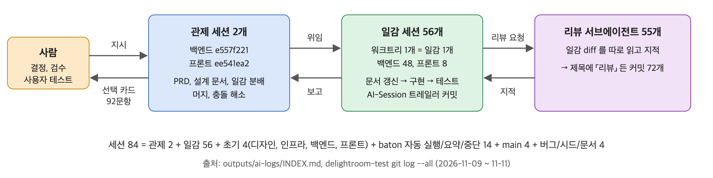

# AI 사용 기록

- 대상: delightroom-test 과제 (2026-11-09 ~ 11-11, KST)
- 원본 로그: [ai-logs/INDEX.md](ai-logs/INDEX.md), 커밋 대응: [ai-logs/COMMITS.md](ai-logs/COMMITS.md)
- 아래 수치, 인용은 모두 로그와 커밋에서 확인한 값

## 1. 도구와 맡긴 일

| 도구 | 규모 | 맡긴 일 |
| --- | --- | --- |
| Claude Code (`claude-opus-5-5`), baton 앱이 띄움 | 세션 84개 | 설계 문서, 구현, 테스트, 머지 |
| 같은 세션의 서브에이전트 | 64개 | 일감 diff 코드 리뷰 55, 설계 문서 작성/점검 9 |
| Codex, 그 밖의 도구 | 0개 | 쓰지 않음 |

| 맡긴 일 | 근거 |
| --- | --- |
| PRD 정리, HLD/LLD/SPEC/ORACLE 작성 | 관제 세션 `e557f221`, 문서 서브에이전트 9 |
| 일감 구현 + 테스트 | 일감 세션 56개 (백엔드 48, 프론트 8) |
| 남의 diff 리뷰 | 리뷰 서브에이전트 55, 제목에 「리뷰」가 든 커밋 72개 |
| 머지, 충돌 해소 | 머지 커밋 110개 중 105개가 `AI-Session` 트레일러 있음 |
| 열린 질문 정리 → 사람에게 선택 카드 | 카드 45장, 92문항 |

- 사람이 직접 한 것: 결정, 검수, 사용자 테스트, GitHub 웹에서 README 수정 7커밋, GitHub PR 머지 3커밋 (committer = GitHub)
- 기록 규칙: 첫 세션에서 레포 `CLAUDE.md` 맨 위에 「AI 기록 헌법」을 넣음 (세션 위치, 원본 불가침, `AI-Session` 트레일러, 커밋 본문 3~5줄)

### 선택 카드 92문항의 결과

| 사람의 답 | 문항 |
| --- | --- |
| AI 추천안 그대로 | 43 |
| AI 의 다른 보기 | 11 |
| 보기 밖 직접 입력 | 24 |
| 답하지 않고 넘김 | 14 |

- 추천안 채택은 절반 이하. 4문항 중 1문항은 사람이 새 답을 씀

## 2. 채택한 AI 제안

| 결정 (prd §12) | AI 제안 | 채택 이유 |
| --- | --- | --- |
| D5 현황판 보조 필드 | 시안의 「도착 시각, n번에서 패스, 접속하지 않음」 값이 API 에 없다고 짚고 `started`, `lastSolvedAt`, `passedAtQuestionNo` 를 선택 필드로 추가 | 셋 다 랭킹 키라 서버가 이미 가진 값. 계약만 늘고 비용 없음 |
| D7 정답 해시 | `SHA-256("<문제 PK>:<정규화한 답>")` | 같은 답도 문제마다 해시가 달라 해시표 재사용 불가. 문제별 무차별 대입 한계는 문서에 적음 |
| D21 처리 못 한 예외 | `INTERNAL_ERROR` 500, `UNAVAILABLE` 503 추가, 모든 오류를 `{code, message}` 로 | Spring 기본 500 본문이 계약 밖. 503 은 재시도, 500 은 재시도 안 함으로 클라이언트가 가를 수 있음 |
| D25 로컬 테스트 환경 | 데모 시계 + 시각 이동 API (보기 3개 중 추천) | 성공 지표 「`docker compose up` 하나로 테스트」를 채우는 유일한 보기. 나머지는 1시간 대기 또는 지표 미충족 |

- 시각: D5 11-11 00:21, D7 00:53, D21 13:20, D25 18:46 (관제 세션 `e557f221` 선택 카드)

## 3. 거절하거나 고친 결정

| 결정 | AI 추천 | 사람의 답 | 이유 |
| --- | --- | --- | --- |
| D13 미접속 표기 | 상태 3개 유지, 「진행 중」 + 「접속하지 않음」 | 「상태 하나 추가」 → 4번째 상태 「미접속」 | 접속 안 한 그룹원을 「진행 중」으로 보이면 그룹원이 오해 (D13 근거) |
| D16 토큰 수명 | JWT 하나, 24시간 | access 5분 / refresh 1시간 → 이어서 1시간 / 2시간으로 다시 바꿈 | refresh 회전 구조로 바꾸고, 토큰 잃은 유저 잠김을 최대 2시간으로 (D16 근거) |
| DDL `CHECK` 제약 | 값 범위를 DB `CHECK` 로 | 「check 는 모두 제거, validation 은 백엔드」 + 테이블/필드 코멘트에 값 설명 | 「제약은 좋지만 이후 확장성에서 불리」 (사람 원문, 세션 `282d334d` 11-10 23:35) |
| D24 참가 자격 | 가입 시각 `joined_at` 도 게임 시계로 (시연 버그 수정) | 「06:49 까지 가입한 회원만 그날 참여」 정책 변경, 06:50 이후 가입자에게 안내만 | 「그러면 문제은행 캐시도 모두 될테니」 — 06:50 문제은행 미리 만들기(D18)와 참가자가 일치 |
| D6 문제 진입 신호 | 노출 신호 API 추가 | ① 「풀이 신호에 다음 문제를 실어 보내」 → AI 가 「1번 문제는 풀기 전에 나와 서버가 모름」 지적 → ② 「각 문제 화면 진입 시 진입 신호」 | 사람 안의 구멍을 AI 가 짚고, 사람이 정책을 다시 씀 |

- 시각: D13 11-11 00:53, D16 02:13 → 02:18/02:20, D24 17:53, D6 00:52 → 00:58

## 4. AI 가 틀렸거나 놓친 것, 발견 경로

| 무엇 | 누가/어떻게 발견 | 처리 |
| --- | --- | --- |
| 3초 유예(D1)를 「마감 확정 08:00:03」으로 넓혀 해석 | 사람이 관제 세션 표를 읽다 「이건 틀린것이야. 마감 확정은 08:00」 (11-11 01:52) | D17 로 08:00 확정, 3번 문제 푸는 그룹만 08:00:03. D1 귀결 정정 |
| 인증 필터가 원문 경로 접두만 봄 → `/%61pi/…`, `/api;x=1/…` 우회 | 리뷰 서브에이전트 (T-PF-4) | `42eb107` PathPattern 매칭 + 회귀 테스트 |
| 빈 DB 기동 때 api/worker 가 서로 잠가 deadlock `40P01` | 프론트 관제가 e2e 를 돌리다 발견 (11-11 17:49) | T-PF-12 `26e8e75` advisory lock, 이후 e2e 3/3 통과 |
| 06:50 이후 가입한 그룹원이 카드에 안 보임 | 사람이 직접 2명 가입해 테스트 (11-11 19:39) | `16c1b18` 「내일부터」 표기, 진행/결과/랭킹엔 미포함 |
| 다른 프로젝트 문서 2건을 과제 레포에 넣음 | 사람이 「이 프로젝트 문서만 넣었는지 검수」 요청 → AI 가 baton 문서 연결 조회로 확인 | `1a821a1` 후속 커밋으로 제거 (앞 커밋은 보존) |

- 발견 경로 정리
  - 사람 검토: 문서 표 읽기, 직접 테스트, 검수 요청
  - AI 끼리 교차 검토: 일감마다 리뷰 서브에이전트, 관제의 e2e
- 반대 방향도 있었음
  - 「정규화 규칙이 누락된 거야?」 (11-11 15:03) → AI 「아니오, R-A2 에 있음. 미결은 적용 범위(전각 공백, 대소문자, NFC)」 → D22 로 33개 공백 문자, NFC, A-Z 만 소문자 확정
