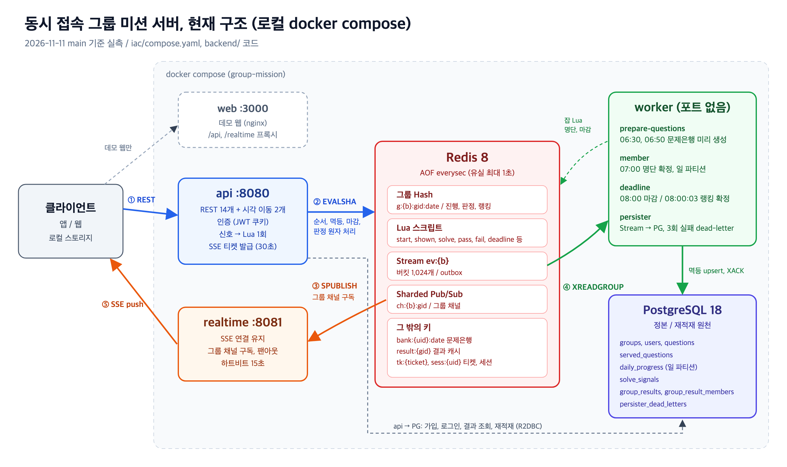
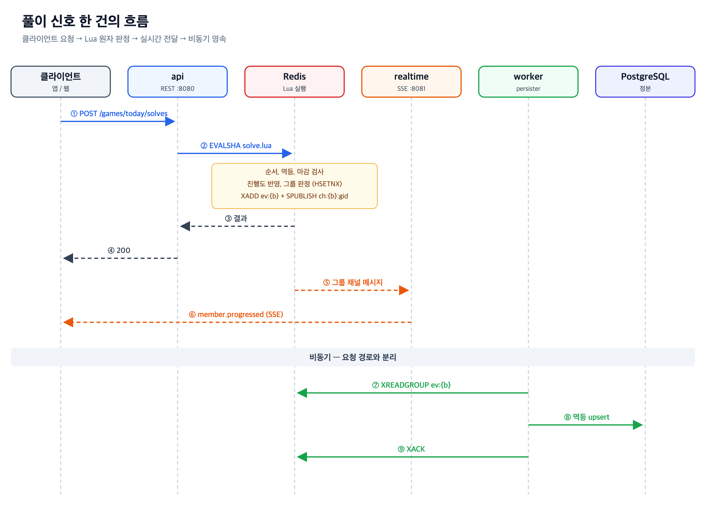
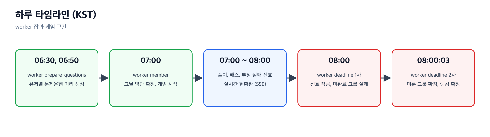
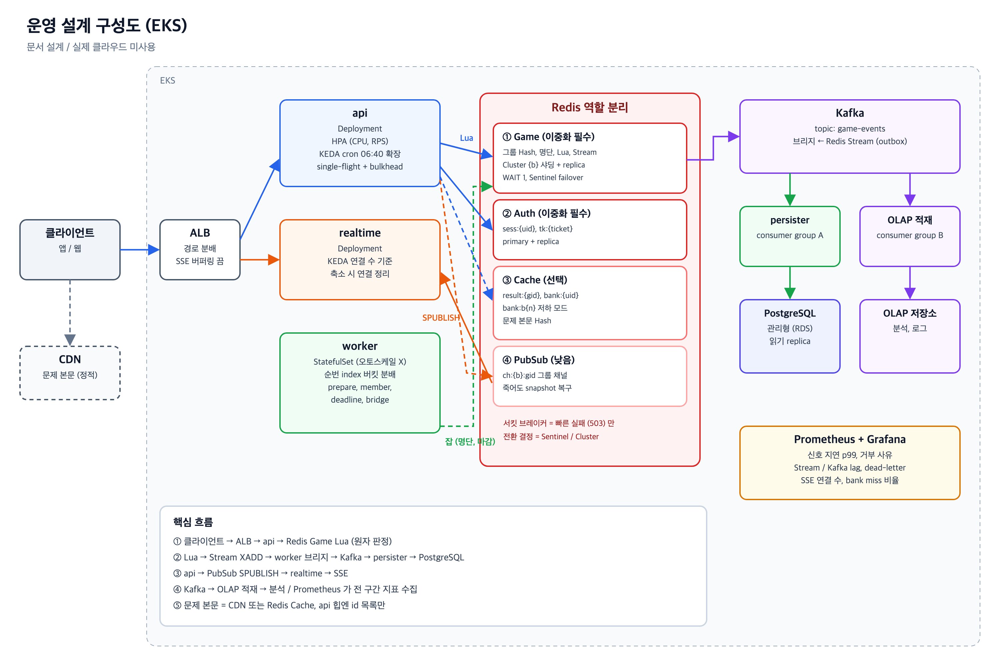
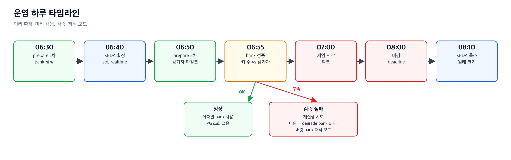
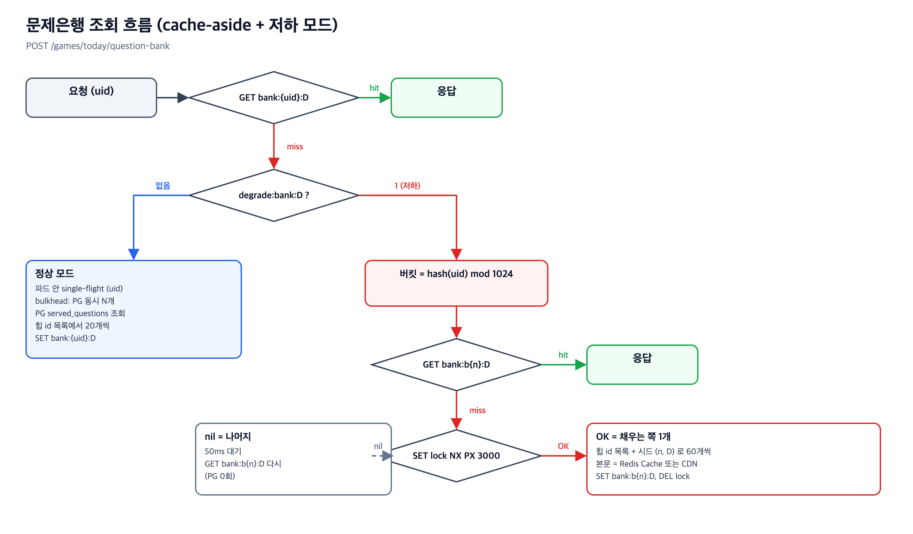
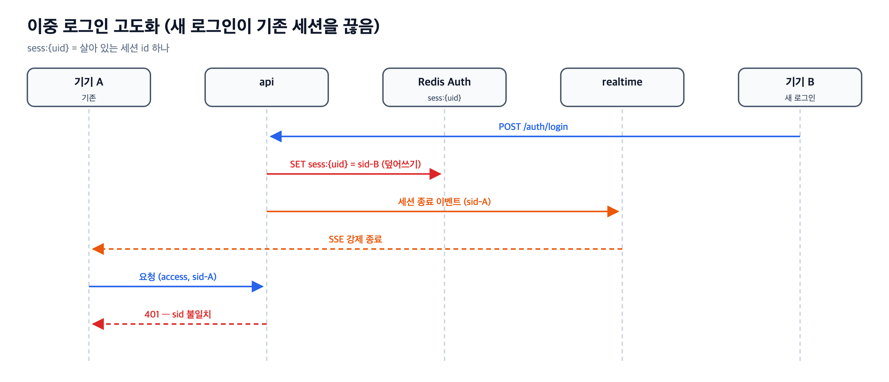

# DESIGN — 동시 접속 그룹 미션 서버

> 기준 — https://github.com/noggong/dlr-test main (2026-11-11 실측)
> 기능별 상세 — [`docs/hld`](https://github.com/noggong/dlr-test/tree/main/docs/hld), [`docs/lld`](https://github.com/noggong/dlr-test/tree/main/docs/lld), [`docs/prd.md`](https://github.com/noggong/dlr-test/blob/main/docs/prd.md) §12 결정 기록

---

## 0. 과제 원문과 다른 점

> 원문 — [DelightRoom Backend Engineer 사전과제](https://app.notion.com/p/droomws/DelightRoom-Backend-Engineer-4073c341ddd780d6911ccc262fd73495)

### 0.1 다른 요소 (요구 충족, 방식 다름)

| 항목 | 원문 | 구현 | 코멘트 |
|---|---|---|---|
| 문제 출제 | 출제, 판정 = 클라이언트. 서버는 「몇 번 풀었다」 신호만 | 서버가 문제은행 (난이도별 20개, 정답 해시) 전달 → 클라이언트가 골라서 판정 | 판정 주체는 원문대로. 서버는 출제 이력까지 앎 |
| 인증 | 가짜 인증 허용 | 실제 가입, bcrypt, JWT 쿠키 (access 1시간, refresh 2시간), 중복 로그인 금지 | 요구보다 강화 |
| 실시간 전달 | 방식 자유 | SSE + Redis Sharded Pub/Sub, 1회용 티켓 | 근거 → §2, §3 |
| 랭킹 | 푼 수 많은 순 → 먼저 푼 순 | 부정 실패 꼴등 → 진행도 → 마지막 풀이 서버 도착 시각 → 패스 → 지각 | 원문 2개 키 유지, 동점 규칙 추가 |
| 그룹 상태 | 진행 중, 성공, 실패 | `IN_PROGRESS`, `PENDING`, `SUCCEEDED`, `FAILED` | 08:00 ~ 08:00:03 확정 대기용 `PENDING` |
| 그룹원 상태 | 진행도 0 ~ 3 | 진행도 -1 (미접속) ~ 3 | 「접속 안 함」과 「0문제」 구분 |
| 시간 밖 결과 | 08:00 이후 오늘 결과 | 00:00 ~ 07:00 은 직전 게임 결과 | 원문에 없는 구간 가정 |
| 1명 그룹 | 그룹 2 ~ 10명 | 1명 그룹 = 게임, 결과 없음 | 원문 범위 밖 상황 처리 |

### 0.2 추가된 요소 (원문에 없음)

| 항목 | 내용 | 코멘트 |
|---|---|---|
| 가입, 그룹 생성 | `signup`, 그룹명 규칙, 정원 10명 | 원문은 「그룹 소속」 전제만 |
| 세션 API | `refresh`, `logout`, `auth/me` | 쿠키 인증에 필요 |
| 패스 | 하루 1번 문제 교체 | 게임 규칙 추가 |
| 부정 실패 | 로컬 스토리지 유실 → 즉시 실패 신호 | 게임 규칙 추가 |
| 진입 신호 | `shown` — 화면에 나간 문제 기록 | 재접속 시 같은 문제, 출제 이력 |
| 지각 | 첫 문제은행 요청 07:00:03 초과 | 랭킹 동점 규칙용 |
| 문제은행 미리 생성 | worker `prepare-questions` (06:30, 06:50) | 07:00 몰림 대응 |
| 재적재, dead-letter, 결과 캐시 | Redis 비면 PG 로 복원, 3회 실패 메시지 보관, `result:{gid}` | 재시작 유지 요구 이상의 내구성 |
| 오류 응답 규약 | 503 `UNAVAILABLE`, 500 `INTERNAL_ERROR` | 클라이언트 재시도 판단용 |
| 데모 시계 | 기동 3분 뒤 07:00, 시각 이동 API | 로컬 하루 전체 확인용. 운영 꺼짐 |
| 웹 클라이언트 | `frontend/` + `web` 컨테이너 | 원문 「클라이언트 만들지 않음」 — 데모, 검증용 |
| 시드 데이터 | 회원 500명, 그룹 87개, 문제 300개 | 로컬 compose 전용 |

### 0.3 틀린 요소 (원문 문장과 어긋남)

| 항목 | 원문 | 구현 | 코멘트 |
|---|---|---|---|
| 마감 반영 | 「08:00:00 이후 도착 신호는 **어떤 경우에도** 미반영」 | 08:00 전 클릭이면 08:00:03 도착까지 반영 | 알고 택한 충돌 — 「08:00 이전 제출자 모두 인정」 우선 (§3) |
| 마감 실패 확정 | 08:00 에 미완료 그룹 실패 확정 | 3번 문제 진행 중 그룹은 08:00:03 확정 | 마감 가드의 결과 |
| 자동 참가 | 「**모든** 유저 매일 자동 참가」 | 그날 06:50 전 가입자만 참가 | 문제은행 미리 생성 마감에 맞춘 제한 |
| compose 파일명 | `docker-compose.yml` | `compose.yaml` (`iac/compose.yaml` include) | `docker compose up` 동작 동일, 이름만 다름 |

---

## 1. 아키텍처

### 1.1 컴포넌트

| 컴포넌트 | 포트 | 역할 | 상태 |
|---|---|---|---|
| 클라이언트 | — | REST 명령, SSE 수신, 정답 판정 (해시 비교) | 로컬 스토리지 |
| `api` | 8080 | 가입, 로그인, 게임 정보, 문제은행, 신호, 현황판 조회, 결과, SSE 티켓 | 무상태 |
| `realtime` | 8081 | SSE 연결 유지, 그룹 채널 구독, 그룹원에게 팬아웃 | 연결만 |
| `worker` | 없음 | 시각 기반 잡 3개 + Stream 영속 | 무상태 (소비 위치 = Redis) |
| Redis 8 | 미노출 | 그날 상태, 원자 판정, 이벤트, 전달 | AOF `everysec` |
| PostgreSQL 18 | 미노출 | 정본, 재적재 원천, 지난 결과 | 볼륨 |
| `web` | 3000 | 데모 웹 (서버 아님), nginx 정적 + `/api`, `/realtime` 프록시 | — |

**api**

- REST 14개 + 로컬 시각 이동 2개 (`docs/api/openapi.yaml`)
- 신호 (풀이, 패스, 부정 실패, 진입) → Redis Lua 1회 실행
- 인증 = JWT 쿠키 (access 1시간, refresh 2시간)
- 오류 형식 = `{ code, message }`, 의존 장애 503 `UNAVAILABLE` / 그 밖 500 `INTERNAL_ERROR`

**realtime**

- 연결 = `api` 가 준 1회용 티켓 (30초)
- 첫 메시지 = `board.snapshot` (현황판 전체)
- 이후 = `member.progressed`, `group.pending`, `group.result`, `group.ranking_final`
- 하트비트 15초, `Last-Event-ID` 안 씀 → 재연결 시 snapshot 으로 복구

**worker**

| 잡 | 시각 (KST) | 일 |
|---|---|---|
| `prepare-questions` | 06:30, 06:50 | 유저별 문제은행 미리 생성 → `bank:{uid}:date` |
| `member` | 07:00 | 그날 명단 확정, 일 파티션 생성, 재적재 감시 |
| `deadline` | 08:00, 08:00:03 | 마감 1차 / 미룬 그룹 확정 + 랭킹 확정 |
| `persister` | 상시 | Stream → PostgreSQL 멱등 기록, 3회 실패 → `persister_dead_letters` |

**Redis 키**

| 키 | 용도 |
|---|---|
| `g:{b}:gid:date` | 그룹 Hash — 진행도, 상태, 판정, 랭킹 |
| `ev:{b}` | 이벤트 Stream (버킷 1,024개) |
| `ch:{b}:gid` | 그룹 채널 (Sharded Pub/Sub) |
| `bank:{uid}:date` | 문제은행 (08:00 만료) |
| `result:{gid}` | 결과 캐시 (25시간) |
| `tk:{ticket}`, `sess:{uid}` | SSE 티켓, 로그인 세션 |

- `{b}` = 그룹 버킷 `gid mod 1024` → 한 그룹 키 전부 같은 슬롯

**PostgreSQL 테이블**

- `groups`, `users`, `questions`
- `served_questions` — 출제 이력 (평생 중복 금지)
- `daily_progress` — 일 파티션
- `solve_signals`, `group_results`, `group_result_members`
- `persister_dead_letters`

### 1.2 신호 한 건의 흐름

- `EVALSHA` (저장된 Lua 실행), `XADD` (Stream 에 추가), `SPUBLISH` (샤드 채널 발행)
- `XREADGROUP` (소비 그룹으로 읽기), `XACK` (처리 완료 표시)

### 1.3 하루 타임라인

---

## 2. 주요 설계 결정과 이유

| # | 결정 | 이유 |
|---|---|---|
| 1 | 그날 상태 = Redis 그룹 Hash, 판정 = Lua 1회 | 07:00 몰림에서 행 잠금 경합 회피, 그룹 안 신호 직렬화 |
| 2 | 마감 시각 = Lua 안 Redis `TIME` (서버 시각) | 앱 서버 시계 차이 제거, 단일 시계 |
| 3 | 결과 1회 기록 = `HSETNX` (없을 때만 쓰기) | 성공 판정, 완료 시각 정확히 1회. PG `UNIQUE` 로 한 번 더 |
| 4 | 이벤트 = Lua 안 `XADD` (outbox) → worker 가 PG 기록 | 판정과 이벤트가 원자. 요청 경로에 DB 쓰기 없음 |
| 5 | 실시간 = SSE + Sharded Pub/Sub | 서버 → 클라이언트 단방향만 필요, 명령은 전부 REST |
| 6 | SSE 인증 = 1회용 티켓 (30초) | 웹 `EventSource` 가 헤더를 못 실음 |
| 7 | 그룹 버킷 `{b}` 해시태그 (1,024개) | 운영 Redis Cluster 전환 시 키 이름 그대로 |
| 8 | 문제은행 미리 생성 (06:30, 06:50) | 07:00 250만 요청 시 PG 조회 회피 |
| 9 | 정답 판정 = 클라이언트 (서버는 해시만) | 원문 요구. 정규화 규칙 + 공유 테스트 벡터로 양쪽 일치 |
| 10 | 마감 가드 = 08:00 이전 클릭이면 08:00:03 도착까지 인정 | 「08:00 이전 제출자 모두 인정」 원칙 우선 |
| 11 | 인증 = JWT 쿠키 + 중복 로그인 금지 (`sess:{uid}`) | 무상태 검증, 계정당 세션 하나 |
| 12 | 처리 못 한 이벤트 = 3회 실패 후 PG dead-letter | 한 메시지가 버킷 전체를 막지 않게 |
| 13 | 로컬 데모 시계 + 시각 이동 API | `docker compose up` 하나로 하루 전체 확인 |

---

## 3. 트레이드오프

| 선택 | 얻은 것 | 잃은 것 / 위험 |
|---|---|---|
| Redis 핫 경로 + AOF `everysec` | 낮은 지연, 원자 판정 | Redis 프로세스 장애 시 **최대 1초 유실** (허용 범위로 명시) |
| PG 비동기 영속 (Stream → worker) | 요청 경로 가벼움 | PG 반영 지연, Redis 유실분은 PG 에도 없음 |
| 재적재 (PG → Redis) | Redis 가 비어도 그날 상태 복원 | persister 가 못 쓴 반영은 함께 사라짐 |
| 마감 가드 3초 | 늦게 도착한 정상 제출 인정 | 원문 NFR-1 (08:00 이후 도착 미반영) 과 충돌 — 알고 택함 |
| 클라이언트 정답 판정 | 서버 부하 없음 | 클라이언트 조작 가능성 (원문 전제) |
| SSE (WebSocket 아님) | 단순, 프록시 친화 | 클라이언트 → 서버 실시간 채널 없음 (필요 없음) |
| `Last-Event-ID` 안 씀 | 서버가 놓친 이벤트 보관 안 함 | 재연결마다 snapshot 전체 전송 |
| worker 버킷 고정 분배 | 버킷 안 순서 보장 | 오토스케일, 겹치는 롤링 배포 불가 |
| dead-letter 3회 | 버킷 막힘 방지 | dead-letter 간 결과는 Redis 에만 남음 |

**버린 대안**

| 영역 | 버린 것 | 이유 |
|---|---|---|
| 판정 저장소 | PostgreSQL 단독 | 07:00 몰림 행 잠금 경합 |
| 판정 저장소 | Redis + PG 동기 쓰기 | 지연, DB 부하 |
| 이벤트 로그 | Kafka | compose, 운영 무거움, 이 규모에 과함 |
| 실시간 | WebSocket | 양방향 불필요, 업그레이드와 프록시 부담 |
| 실시간 | 폴링 | 250만 × 주기 비용 |

---

## 4. 하지 않은 것과 이유

| 항목 | 이유 |
|---|---|
| 결제, 보상 지급, 그룹 탈퇴와 이동 | 원문 범위 밖 |
| 실제 클라우드 리소스 | 원문 제약 — 운영 확장은 문서로만 (§5) |
| Redis Cluster, replica (로컬) | 로컬은 단일 Redis. 키 설계만 Cluster 대응 |
| 지표 외부 내보내기 (Prometheus) | 범위 밖 결정. 지표는 앱 안 `MeterRegistry` 에만 |
| dead-letter 재처리, 조회 API | 범위 밖 결정. 운영자가 SQL 로 확인 |
| `Last-Event-ID` 이어 받기 | snapshot 으로 충분 |
| 출제 이력 Redis 캐시 | 정본 `served_questions` 만 사용 |

**알려진 문제**

- 08:00 뒤 Redis, worker 동시 재시작 → 그날 그룹 Hash 자동 복원 안 됨
- 그 그룹 요청이 오면 그 그룹만 복원
- 해결안 = 기동 시 그날 기록 있는 그룹 재적재 전용 실행 (미구현)

---

## 5. 운영 설계 (문서로만)

> 실제 클라우드 리소스는 쓰지 않음 (원문 제약). 아래는 운영 환경이라면 더할 것

### 5.1 구성도

| 영역 | 설계 | 이유 |
|---|---|---|
| 플랫폼 | EKS. `api`, `realtime` = Deployment, `worker` = StatefulSet | worker 는 순번 index 로 버킷 `b mod 수 == index` 를 나눠 받음 |
| 진입 | ALB — 경로로 `api`, `realtime` 분배. SSE 경로 버퍼링 끔, 긴 idle timeout | SSE 연결 유지 |
| PostgreSQL | 관리형 (RDS) + 읽기 replica (결과 조회), `served_questions` 파티셔닝 | 정본 보호 |
| 문제 본문 | api 힙엔 난이도별 id 목록만, 본문은 Redis Cache 또는 CDN | 문제 1,000만 개면 힙 사본 약 2.6 GB (현재 660개 175 kB 실측 기준 비례) |

### 5.2 확장 (Auto scaling, KEDA)

| 대상 | 방식 | 비고 |
|---|---|---|
| `api` | HPA (CPU, RPS) + KEDA cron | 06:40 확장, 08:10 축소 |
| `realtime` | KEDA 연결 수 기준 + cron | 축소 시 연결 정리 시간. 1대 5만 연결 기준 약 50대 |
| `worker` | **오토스케일 금지** | 인스턴스가 겹치면 버킷 순서 깨짐. 바꿀 때는 옛 인스턴스 먼저 내림 |

- HPA 만으론 늦음 — 파드 기동, JVM 워밍업. 07:00 몰림은 예측 가능 → 시간 예약으로 미리 확장

### 5.3 Redis 역할 분리와 이중화

| 분리 | 담는 것 | 이중화 | 장애 시 |
|---|---|---|---|
| ① Game | 그룹 Hash, 명단, Lua, Stream `ev:{b}` | **필수** — Cluster `{b}` 샤딩 + replica, `WAIT 1` | 게임 정지 → PG 재적재로 복구 |
| ② Auth | `sess:{uid}`, `tk:{ticket}` | **필수** — primary + replica | 전원 로그아웃 → 07:00 로그인 폭주 |
| ③ Cache | `result:{gid}`, `bank:{uid}:D`, `bank:b{n}:D`, 문제 본문 | 선택 | PG fallback (bank 는 저하 모드) |
| ④ PubSub | `ch:{b}:gid` | 낮음 | 실시간만 멈춤 → 재연결 snapshot 으로 복구, 손실 없음 |

- **전환 결정 = Sentinel / Cluster** (Redis 자체 failover). 앱은 토폴로지 갱신으로 새 primary 에 재연결
- **서킷 브레이커 = 빠른 실패만** — 열리면 503 `UNAVAILABLE`. 앱이 다른 Redis 로 전환하면 split-brain (두 곳에 따로 쓰기) → 1회 판정, 멱등 깨짐
- **복제 지연 위험** — 비동기 복제라 failover 시 마지막 쓰기 유실 가능. `HSETNX` 결과가 빠지면 판정 재발생 → PG `UNIQUE` 가 이중 기록 차단, `WAIT 1` 로 창 축소
- **분리 대가** — 지금은 Lua 안 `SPUBLISH` 가 원자. PubSub 분리 시 Lua 뒤 `api` 가 publish → 그 사이 장애면 누락 → snapshot 이 메움 (허용)
- **Game 은 더 쪼개지 않음** — 한 그룹 키가 같은 슬롯 `{b}` 에 있어야 Lua 원자 판정 성립
- 우선순위 = Game > Auth > Cache > PubSub

### 5.4 Kafka 와 로그 파이프라인

| 항목 | 설계 |
|---|---|
| 위치 | Redis **뒤**. Lua `XADD` (outbox) → worker 브리지 → Kafka `game-events` |
| consumer group A | `persister` → PostgreSQL 멱등 기록 |
| consumer group B | OLAP 적재 → 분석, 로그 |
| Redis 앞에 두지 않는 이유 | 판정은 요청 안에서 Lua 원자 처리 + 즉시 응답. 사이에 큐를 두면 동기 판정 불가 |

### 5.5 캐시 설계

| 캐시 | 키 | 채움 | TTL / 만료 | miss 시 |
|---|---|---|---|---|
| 문제 목록 | api 힙 (id 목록) | 기동 시 1회 | 재기동까지 | — |
| 문제 본문 | Redis Hash / CDN | 문제 등록 시 | 없음 | PG |
| 유저 문제은행 | `bank:{uid}:D` | 06:30, 06:50 미리 생성 | 08:00 | 정상 = PG 조회 후 생성, 저하 = 버킷 은행 |
| 버킷 문제은행 | `bank:b{n}:D` | 저하 모드에서 cache-aside | 08:00 | `SET NX` 잠금, 1개만 생성 |
| 결과 | `result:{gid}` | persister 기록 후 갱신 | 25시간 | PG 조회 후 `SET NX` |

**스탬피드 방지**

| 상황 | 대응 |
|---|---|
| 같은 키, 같은 파드 | single-flight — 진행 중 조회를 대기자와 공유 |
| 같은 키, 여러 파드 | Redis `SET lock NX PX 3000` (키가 없을 때만 쓰기, 3초 자동 해제) → 1개만 PG, 나머지는 대기 후 재조회 |
| 서로 다른 키 대량 miss | PG 앞 bulkhead (파드당 동시 N개) + 넘치면 503 + `Retry-After`, 클라이언트 재시도 지터 |

- PER (확률적 조기 갱신), DB 비관락은 쓰지 않음 — 피크 중 만료되는 키가 없고, 비관락은 직렬화만 늘림

**문제은행 저하 모드 (07:00 대량 miss)**

| 단계 | 내용 |
|---|---|
| 감지 | 06:55 bank 키 수 vs 참가자 수 검증 → 실패 시 재실행, 그래도 미완이면 `degrade:bank:D = 1` (08:00 만료) |
| 동작 | 버킷 = `hash(uid) mod 1024` → `bank:b{n}:D` 공유. 유저 이력 조회 생략 → PG 0회 |
| 파드 간 일치 | 버킷 은행을 Redis 에 저장 (cache-aside) → 처음 만든 결과가 정본 |
| 잃는 것 | 「이미 낸 문제 제외」, 「평생 1회」 — 중복은 거부 없이 로그 (D15 흐름) |
| 복귀 | 08:00 플래그 만료 → 다음 날 정상 모드 |

### 5.6 모니터링 (Prometheus + Grafana)

| 지표 | 왜 |
|---|---|
| 신호 처리 지연 p50 / p95 / p99 | 핵심 경로 상태 |
| 거부 사유별 건수 | 마감, 순서, 멱등 이상 감지 |
| Stream / Kafka lag, `XPENDING` | persister 지연 → 결과 조회 캐시 miss 증가 |
| dead-letter 건수 | 정본 미반영 이벤트 |
| SSE 연결 수 | `realtime` 확장 기준 |
| bank miss 비율, 저하 모드 여부 | 07:00 위험 |
| worker 잡 성공 여부 (prepare, member, deadline) | 판 깔기 실패 조기 경보 |

- 현재는 범위 밖 — 지표가 앱 안 `MeterRegistry` 에만 있음. registry 의존 추가 + actuator 노출 필요

### 5.7 이중 로그인 고도화

| 현재 빈틈 | 고도화 |
|---|---|
| 나중 로그인 거절 (`SET NX` → 409) → 앱 비정상 종료 시 `sess` 만료까지 최대 2시간 재로그인 불가 | 새 로그인이 기존 세션을 끊음 (`sess:{uid}` 덮어쓰기) |
| access token 무상태 → `sess` 를 지워도 1시간 유효 (ORACLE O29) | access 에 세션 id 포함, 검증 시 `sess:{uid}` 대조 → 불일치 401 |
| 끊긴 기기 SSE 유지 | 세션 종료 이벤트 → `realtime` 이 그 기기 SSE 강제 종료 |

### 5.8 검토했지만 버린 것

| 제안 | 판정 | 이유 |
|---|---|---|
| 서킷 브레이커로 다른 Redis 전환 | 거절 | split-brain |
| Redis 앞에 Kafka | 거절 | 동기 원자 판정 불가 |
| PER | 보류 | 피크 중 만료 키 없음 |
| DB 비관락 | 거절 | 스탬피드 방지가 아니라 직렬화 |
| 버킷 문제은행 상시 사용 | 거절 | 「이미 낸 문제 제외」 규칙 위반 → 비상시만 |

## 6. SLI / SLO / SLA

> 근거 — 부하 테스트 실측 [`loadtest/`](loadtest/README.md), 원본 `loadtest/results/day-20261111-225152` (① ② ③), `bank-20261111-225359` (④)
> 환경 — Apple M4 Pro 12코어, RAM 48 GB, Docker VM 12 CPU / 7.75 GiB, 서비스 자원 제한 없음, 부하 도구 같은 머신
> 규모 — 회원 500명, 그룹 87개 (실제 대비 1/5,000)

- **측정 기간** — 게임 시간 07:00 ~ 08:00:03 (하루 1시간). SLO, SLA 모두 이 시간 기준
- **SLO** — 내부 목표. 실측에 여유를 둔 값
- **SLA** — 외부 약속. SLO 보다 느슨함. 월간 게임 시간 기준

| 구간 | SLI | 실측 | SLO | SLA |
|---|---|---|---|---|
| ① 시작 | 문제은행 응답 p99 (캐시 hit) | 49 ms | < 200 ms | < 1 s |
| ① 시작 | 게임 정보 응답 p99 | 39 ms | < 200 ms | < 1 s |
| ① 시작 | SSE 연결 성공률 | 100 % (500/500) | ≥ 99.9 % | ≥ 99.5 % |
| ① 시작 | **로그인 응답 p99** | **4.5 s** (bcrypt) | < 1 s — **현재 미달** | < 3 s |
| ④ 준비 잡 실패 | 문제은행 응답 p99 (캐시 전부 miss, PG 로 생성) | 32 ms (500명, PG `served_questions` 스캔 352회. 로그인이 요청을 흘려 보내 동시성 낮음 → 「PG 경로가 버틴다」 근거 아님) | < 500 ms | < 2 s |
| ② 진행 | 신호 (풀이, 진입) 응답 p99 | 41 ms (신규), 28 ms (재시도 500 동시) | < 100 ms | < 300 ms |
| ② 진행 | 신호 성공률 (5xx 제외) | 100 % (약 198만 건, 대부분 재시도) | ≥ 99.95 % | ≥ 99.9 % |
| ② 진행 | 멱등 — 중복 반영 | 0 건 | 0 건 | 0 건 |
| ② 진행 | 팬아웃 지연 p99 (풀이 → 그룹원 SSE) | 294 ms (부하 도구 CPU 지연 포함, 서버만의 값 아님) | < 1 s | < 3 s |
| ③ 종료 | 마감 정합성 — 08:00:03 뒤, 클릭 ≥ 08:00 반영 | 0 건 (500 신호 분류 4종 위반 0) | 0 건 | 0 건 |
| ③ 종료 | 결과 확정 시각 | 08:00:03.03 이내 | 08:00:05 이내 | 08:00:30 이내 |
| ③ 종료 | 결과 조회 p99 | 28 ms (33,915 건/초) | < 200 ms | < 1 s |
| 내부 | persister PG 반영 지연 p99 | 444 ms | < 5 s | — (내부 지표) |
| 내부 | dead-letter | 0 건 | 0 건 | — |

**SLA 위반 시 조치**

| 위반 | 조치 |
|---|---|
| 정합성 (마감, 멱등) | 0 건 약속 — 위반 즉시 장애 등급, 영향 그룹 결과 재검증, 포스트모템 공개 |
| 지연, 성공률 | 월간 보고, 원인 분석, 다음 게임 전 확장 조정 |
| 보상 | 원문 범위 밖 (결제, 보상 지급 없음) — 공지와 재발 방지만 |

**에러 예산** — 성공률 SLO 99.95 % = 하루 신호 약 750만 건 중 약 3,750 건 (산술 2,083 건/초 × 3,600 초)

---

## 7. 250만 규모 용량 산정

> 기준 = 위 맥북 실측. 실측 아닌 값은 「가정」 표시

**실측 단위 처리량**

| 경로 | 실측 처리량 | 그때 자원 | 단위당 |
|---|---|---|---|
| 신호 (재시도 500 동시) | 48,929 건/초, p99 28 ms | api CPU 평균 484 % (약 4.8 코어) | **api 1 코어 ≈ 1만 건/초** — Lua `REPLAY` 읽기 경로라 상한값. 쓰기 경로 지속 처리량은 미측정 |
| 신호 Lua (solve) | 평균 42 µs | Redis CPU 평균 68 % | **Redis 1 샤드 ≈ 2.3만 건/초 (100 %)** |
| 로그인 | 500 건 / 4.55 초 ≈ 110 건/초 | api CPU 최대 989 % (약 10 코어) | **api 1 코어 ≈ 11 건/초** |
| persister | 최대 3,622 건/초, 끝난 뒤 0.86 초에 비움 | worker CPU 최대 67 % | **worker 1 대 ≈ 5천 건/초** |
| SSE | 500 연결 | realtime 메모리 602 MiB (JVM 기본 포함) | 연결당 비용은 이 규모로 못 가름 |
| 그룹 Hash | 평균 643 B, 최대 1,062 B | — | — |

**250만 산정** (여유율 = 목표 사용률 50 %)

| 대상 | 산식 | 산정 |
|---|---|---|
| `api` (신호) | 피크 2만 건/초 ÷ 1만 건/초/코어 ÷ 0.5 → 쓰기 경로는 더 무거우므로 ×2 | **약 4 ~ 8 코어** |
| `api` (로그인) | 250만 명이 06:30 ~ 07:00 에 로그인 가정 → 약 1,390 건/초 ÷ 11 ÷ 0.5 | **약 250 코어 — 최대 병목** |
| Redis Game | 피크 2만 건/초 ÷ 2.3만 ÷ 0.5 → 2 샤드 | **Cluster 3 샤드 + replica 3** (Cluster 최소 3) |
| Redis 메모리 | 그룹 125만 × 1,062 B ≈ 1.3 GB + Stream, 명단, bank | 샤드당 4 GB 이상 (bank 크기는 확인 필요) |
| PostgreSQL (④ 대량 miss) | 500명 miss 에 api PG 연결 최대 10 (풀 상한) 도달 → 250만 miss 면 풀 대기가 먼저 막힘 | 06:55 검증 + 저하 모드 (§5.5) 로 PG 0회 유지, bulkhead |
| `worker` persister | 피크 이벤트 2만 건/초 ÷ 5천 ÷ 0.5 | **8 인스턴스** (StatefulSet) |
| `realtime` | 250만 연결 ÷ 1대 5만 연결 (가정) | **약 50 파드** |
| PostgreSQL | 실측 CPU 최대 16 % (500명) — 쓰기는 persister 경유 비동기 | 관리형 + 읽기 replica, 사양은 쓰기량 실측 필요 |

**로그인 병목 대응**

| 대응 | 효과 |
|---|---|
| refresh 를 하루 넘게 (예: 24시간) | 매일 아침 로그인 자체를 없앰 → 07:00 전 로그인 몰림 제거 |
| bcrypt cost 조정 (현재 10) | cost 1 낮추면 비용 절반 |
| 로그인 전용 파드 + 06:00 부터 예약 확장 | 피크 분산 |

## 8. 참고 — 설계 산술

**규모 산술**

| 양 | 값 |
|---|---|
| 동시 SSE 연결 | 최대 250만 |
| 풀이 신호 평균 | 약 2,083 건/초 (피크 10배 약 2만 건/초) |
| 07:00 문제은행 요청 | 최대 250만 건 / 수 분 |
| 그룹 수 | 25만 ~ 125만 |

- 측정 결과 → [`loadtest/`](loadtest/README.md)
