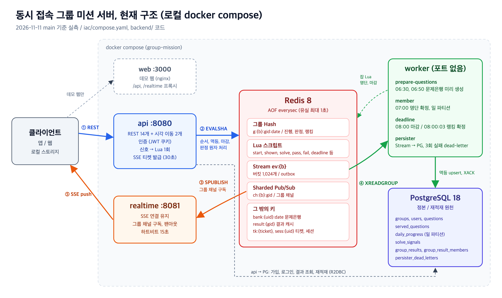
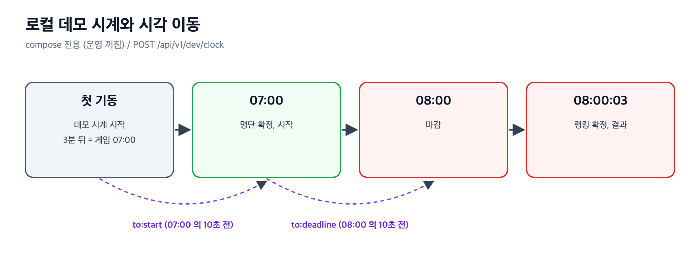
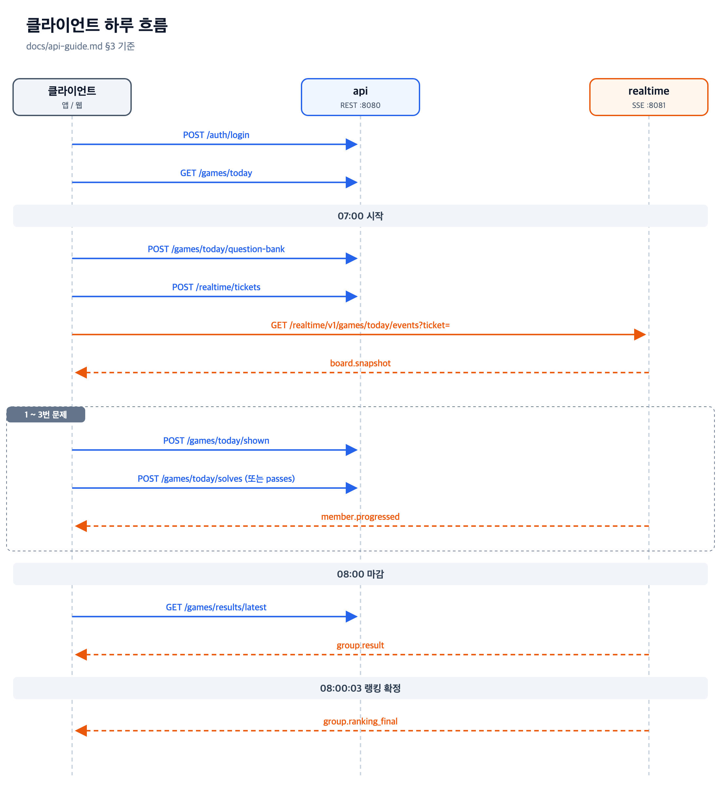

# 동시 접속 그룹 미션 서버

> 딜라이트룸 Backend Engineer 과제 제출물
> 저장소 — https://github.com/noggong/dlr-test

| 항목 | 값 |
|---|---|
| 게임 시간 | 매일 07:00 ~ 08:00 KST |
| 규모 | 일일 250만 명, 동시 접속 |
| 그룹 | 2 ~ 10명 |
| 미션 | 1인 퀴즈 3문제 — 정치, 사회, 상식, 시사 |
| 성공 | 그룹원 전원 3문제 완료 |
| 실패 | 08:00 마감 시 미완료 |

---

## 1. 제출물 위치

| 항목 | 위치 |
|---|---|
| 소스 코드 | [`backend/`](https://github.com/noggong/dlr-test/tree/main/backend), [`frontend/`](https://github.com/noggong/dlr-test/tree/main/frontend), [`compose.yaml`](https://github.com/noggong/dlr-test/blob/main/compose.yaml) |
| 커밋 기록 | [main 히스토리](https://github.com/noggong/dlr-test/commits/main) |
| 실행 방법 | 이 문서 §3 |
| API 정의 (REST) | [`docs/api/openapi.yaml`](https://github.com/noggong/dlr-test/blob/main/docs/api/openapi.yaml), [Swagger](https://petstore.swagger.io/?url=https://raw.githubusercontent.com/noggong/dlr-test/main/docs/api/openapi.yaml) |
| API 정의 (실시간 SSE) | [`docs/api/asyncapi.yaml`](https://github.com/noggong/dlr-test/blob/main/docs/api/asyncapi.yaml), [AsyncAPI Studio](https://studio.asyncapi.com/?url=https://raw.githubusercontent.com/noggong/dlr-test/main/docs/api/asyncapi.yaml) |
| 클라이언트 개발 문서 | [`docs/api-guide.md`](https://github.com/noggong/dlr-test/blob/main/docs/api-guide.md) — 공통 규약, 하루 호출 순서, 오류 코드 |
| 기능별 설계 | [`docs/`](https://github.com/noggong/dlr-test/tree/main/docs) — PRD, HLD, LLD, SPEC, ORACLE, [웹 버전](https://noggong.github.io/dlr-test/) |
| 테스트 | [`backend/**/src/test`](https://github.com/noggong/dlr-test/tree/main/backend), [`frontend/`](https://github.com/noggong/dlr-test/tree/main/frontend) |
| 설계 문서 | [`DESIGN.md`](DESIGN.md) |
| 부하 테스트 | [`loadtest/`](loadtest/README.md) |
| AI 사용 기록 | [`AI_USAGE.md`](AI_USAGE.md), [`ai-logs/`](ai-logs/INDEX.md) |

---

## 2. 아키텍처



| 서비스 | 포트 | 역할 |
|---|---|---|
| `api` | 8080 | 가입, 로그인, 게임 정보, 문제은행, 신호, 현황판 조회, 결과, SSE 티켓 |
| `realtime` | 8081 | 그룹 현황판 SSE 전달 |
| `worker` | 없음 | 아래 4개 잡 |
| `redis` | 미노출 | 그룹 Hash, Lua 판정, Stream, Pub/Sub — AOF `everysec` |
| `postgres` | 미노출 | 정본, 재적재 원천 |
| `web` | 3000 | 데모, 검증용 웹 (서버 아님) — nginx 정적 + 같은 출처용 `/api`, `/realtime` 프록시 |

- 서버 진입 = `api`, `realtime` 포트 직접 노출 (앞단 게이트웨이, LB 없음)

**worker 잡**

| 잡 | 시각 (KST) | 일 |
|---|---|---|
| `prepare-questions` | 06:30, 06:50 | 유저별 문제은행 미리 생성 → Redis |
| `member` | 07:00 | 그날 명단 확정, 일 파티션 |
| `deadline` | 08:00, 08:00:03 | 마감 1차, 2차 (랭킹 확정) |
| `persister` | 상시 | Redis Stream → PostgreSQL 영속, 3회 실패 시 dead-letter |

**기술 스택**

| 영역 | 기술 |
|---|---|
| 서버 | Kotlin 2.3, Spring Boot 4.1, WebFlux, Coroutines |
| 저장소 | Redis 8 (Reactive, Lua), PostgreSQL 18 (R2DBC) |
| 웹 | React 18, Vite 5, TypeScript, Tailwind, Storybook |
| 실행 | Docker Compose |

- 상세 → [`DESIGN.md`](DESIGN.md)

---

## 3. 실행 방법

**필요** — Docker (Compose v2.20 이상)

```sh
git clone https://github.com/noggong/dlr-test.git && cd dlr-test
./iac/local.sh up          # 빌드 → 기동 → 헬스 확인
# 또는
docker compose up --build
```

**성공 출력** (`./iac/local.sh up`, 실측)

```
헬스 확인
  ✓ api       http://localhost:8080/health
  ✓ realtime  http://localhost:8081/health
  ✓ web       http://localhost:3000/login
  ✓ worker    running · persister.started
```

| 서비스 | 주소 |
|---|---|
| 웹 클라이언트 | http://localhost:3000/login |
| REST API | http://localhost:8080 |
| 실시간 (SSE) | http://localhost:8081 |
| Redis, PostgreSQL | 호스트 미노출 — `docker compose exec redis redis-cli`, `docker compose exec postgres psql -U mission` |

| 명령 | 동작 |
|---|---|
| `./iac/local.sh check` | 헬스 재확인 |
| `./iac/local.sh env` | 프로젝트 이름, 이미지 태그, 포트 출력 |
| `./iac/local.sh logs` | 로그 보기 |
| `./iac/local.sh down` | 내리기 (데이터 볼륨 유지) |
| `./iac/local.sh down -v` | 내리기 + 데이터 볼륨 삭제 |

- 포트 변경 → `iac/.env` 의 `API_PORT`, `REALTIME_PORT`, `WEB_PORT`

---

## 4. 바로 해 보기

### 4.1 시드 계정

| 항목 | 값 |
|---|---|
| 아이디 | `seed0001` ~ `seed0500` |
| 비밀번호 | `seed-pass-1` (테스트용) |
| 그룹 | `시드 그룹 001` ~ `087` (그룹당 2 ~ 10명) |
| 문제 | 300개 — 카테고리 4종 × 75개 |

- 같은 그룹 회원 여럿 → 브라우저, 시크릿 창 여러 개 로그인 → 현황판 동시 변화
- 같은 그룹 회원 찾기

```sh
docker compose exec -T postgres psql -U mission -c \
  "SELECT g.name, string_agg(u.login_id, ' ' ORDER BY u.login_id)
   FROM users u JOIN groups g ON g.id = u.group_id
   WHERE g.name = '시드 그룹 001' GROUP BY g.name"
```

- 시드 = 빈 DB 첫 기동 시 1회
- 시드 없이 기동 → `API_PROFILES= ./iac/local.sh up`

### 4.2 시각 이동 (로컬 전용)

- 첫 기동 **3분 뒤 = 게임 07:00**
- 운영 기본값 = 꺼짐, compose 만 켬



| 요청 (`/api/v1/dev/clock`) | 이동 |
|---|---|
| `GET` | 지금 게임 시각, 시작, 마감, 랭킹 확정 시각 |
| `POST {"to":"start"}` | 다음 07:00 의 10초 전 |
| `POST {"to":"deadline"}` | 다음 08:00 의 10초 전 |
| `POST {"at":"2026-11-12T07:30:00+09:00"}` | 지정 시각 |

```sh
curl -s -XPOST localhost:8080/api/v1/dev/clock \
  -H 'Content-Type: application/json' -d '{"to":"start"}'
```

- 앞으로만, 한 번에 최대 7일
- 건너뛴 경계 (명단, 마감, 랭킹 확정) → worker 가 차례로 처리한 뒤 응답

---

## 5. 하루 흐름 (클라이언트 기준)



- 정답 판정 = 클라이언트 (서버는 정답 해시만 전달)
- 로컬 스토리지 유실 → `POST /games/today/failures` (부정 실패)
- 상세 → [`docs/api-guide.md`](https://github.com/noggong/dlr-test/blob/main/docs/api-guide.md) §3

---

## 6. 테스트

| 대상 | 명령 | 규모 |
|---|---|---|
| 백엔드 | `./iac/test.sh` (JDK 21 컨테이너, Testcontainers) | 테스트 클래스 110개, 모듈 6개 |
| 웹 단위 | `cd frontend && pnpm test` (Vitest) | 테스트 파일 15개 |
| 종단 (e2e) | `cd frontend && pnpm e2e` (Playwright, 실제 compose) | 하루 한 바퀴, 부정 실패 |
| 데모 시나리오 | `./iac/demo-check.sh` | 가입 → 풀이 → 시각 이동 → 결과 |

- 판정 기준 → 기능별 [ORACLE](https://github.com/noggong/dlr-test/tree/main/docs/oracle)
- 테스트 이름 = ORACLE 기준 id 로 시작 (예: `O40 …`)

---

## 7. 저장소 구조

```
dlr-test/
├── backend/        app(api, realtime, worker), core, infra(redis, rdb), support
├── frontend/       데모, 검증용 웹, Storybook, e2e
├── iac/            compose, Dockerfile, nginx, local.sh, test.sh, demo-check.sh
├── compose.yaml    진입점 (iac/compose.yaml include)
├── docs/           PRD, HLD, LLD, SPEC, ORACLE, API 계약, 보관 산출물
├── tools/          문서 빌드, 시드 생성, 정답 정규화 벡터
└── CLAUDE.md       작업 규칙 (AI 기록, 하네스)
```

---

## 8. 작업 방식

| 항목 | 내용 |
|---|---|
| 하네스 | 기능마다 구현 전 **HLD → LLD → SPEC → ORACLE** |
| 브랜치 | 기능 브랜치 → main merge, squash, rebase 없음 |
| 커밋 | 381개, merge 109개 (2026-11-11 기준) |
| AI 기록 | 커밋 메시지 `AI-Session: <세션 ID>` 트레일러 — 368 / 381 커밋 |
| 규칙 원문 | [`CLAUDE.md`](https://github.com/noggong/dlr-test/blob/main/CLAUDE.md) |
